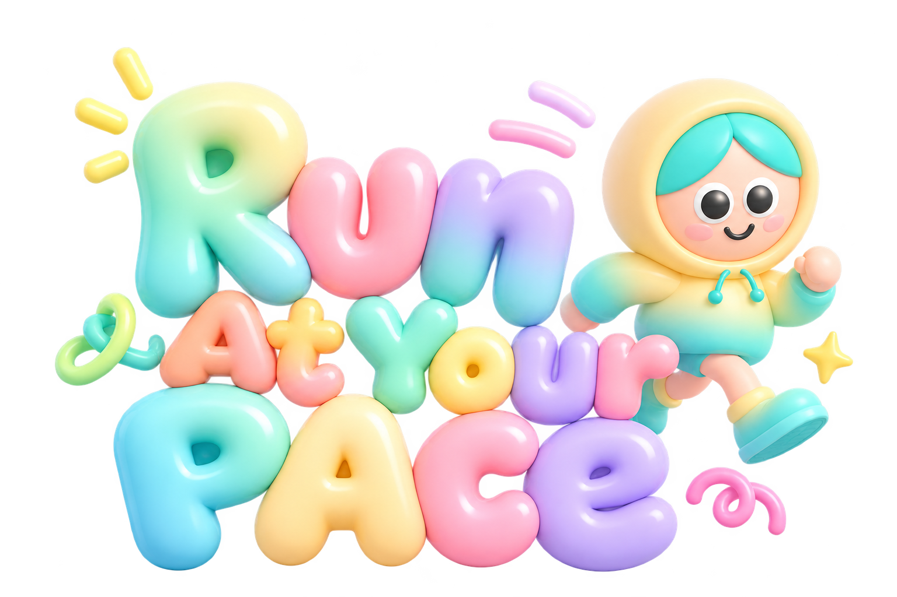
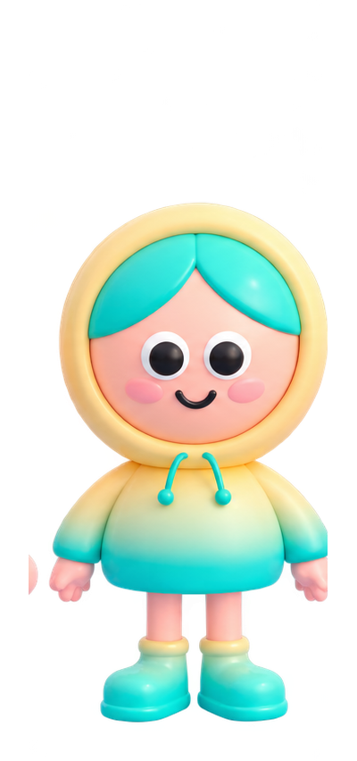
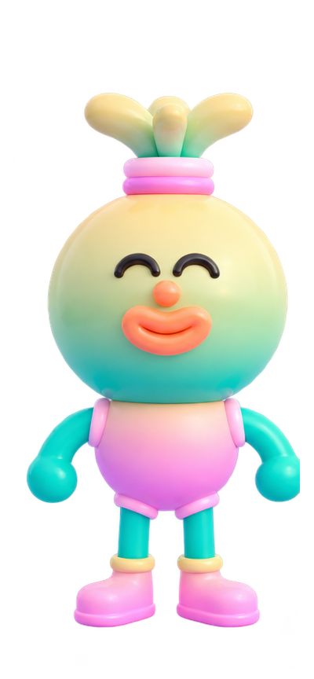
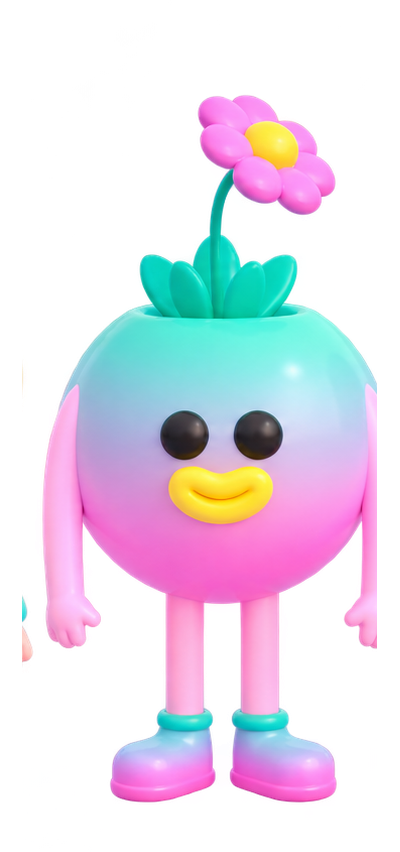
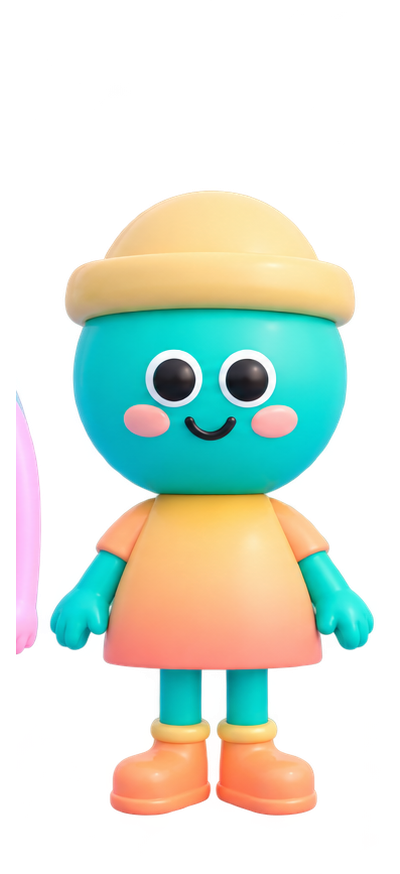
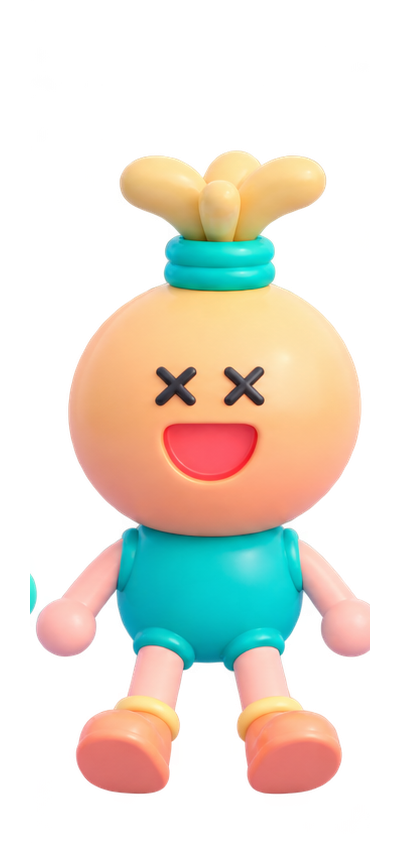

# Run at your pace — 프로젝트 소개

**🔗 데모:** https://run-at-your-pace.ai.studio

## 어제 뛴 10km, 오늘은 게임이 됩니다.

워치를 멈추는 순간, 당신의 러닝은 지도 위의 가는 선 하나와 숫자 몇 개로 끝납니다. 땀 흘리며 달린 그 길이 한 번 보고 닫는 기록으로만 남는다면 너무 아깝지 않나요?

**Run at your pace는 GPX 파일 하나를 창에 끌어다 놓는 것만으로, 내가 실제로 달린 길을 포근한 파스텔 세상 속 3D 러닝 게임 코스로 바꿔 줍니다.** 한강변도, 남산 길도, 우리 동네 공원도, 이번에는 내가 달리는 게임의 스테이지입니다.

**내 페이스가 곧 게임 속 속도입니다.** 숨이 턱까지 찼던 오르막은 게임에서도 천천히, 치고 나갔던 직선은 시원하게 빠르게. 이름 그대로, 내 페이스대로 달립니다.

---

## 누구의 어떤 문제인가
**대상:** 러닝 앱이나 워치로 기록은 꾸준히 남기지만, 그 기록을 다시 열어 볼 일이 거의 없는 취미 러너와 러닝 크루.

러닝 기록은 대부분 "한 번 확인하고 닫는" 데이터입니다. 거리와 페이스는 알려 주지만 다시 그 길을 달리고 싶게 만들지는 못합니다. Run at your pace는 이미 갖고 있는 GPX 파일을 재료로, 기록을 **다시 열어 보고, 다시 달려 보고, 쌓아 가는** 대상으로 바꿉니다. 새 기기도, 계정도, 별도 기록 작업도 필요 없습니다. GPX는 주요 러닝 플랫폼이 공통으로 내보내는 형식이라 시작 장벽이 낮습니다.

## 어떻게 다른가
- **내 길이 곧 스테이지:** 미리 만들어진 맵이 아니라, 내가 실제로 달린 경로(굽이, 거리, 구간 페이스)에서 코스가 만들어집니다.
- **내 페이스가 곧 게임 속 속도:** 느리게 달린 구간은 느리게, 빠르게 달린 구간은 빠르게. 발걸음도 내 페이스를 따라갑니다.
- **기록과 게임을 한 화면에서:** 1km 스플릿 리포트, 평균 페이스, 미니맵 같은 실제 러닝 데이터를 유지한 채 코인 모으기 게임으로 이어집니다.
- **개인정보 부담 없음:** GPX 파싱과 계산을 전부 브라우저에서 처리하고 서버로 보내지 않습니다. 위치 기록이 민감하다는 점을 고려한 구조입니다.

---

## 왜 끌리는가

### 1. 드롭 한 번이면 끝, 내 길이 곧 코스
Strava, Garmin, Nike Run Club, Apple Watch 어디서 뛰었든 GPX만 있으면 됩니다. 파일을 끌어다 놓으면 기다림 없이 바로 플레이 가능한 코스가 만들어집니다. 계정 연동도, 서버 업로드도 없습니다. 모든 처리는 내 브라우저 안에서 이루어집니다.

### 2. 보는 순간 힐링되는 양모 펠트 세상
네온 민트 잔디밭, 솜털처럼 부푼 핑크빛 나무, 몽실몽실 구름. 장난감 같은 펠트 질감의 러너가 그 사이를 달립니다. 테마는 4가지입니다.
- 🌸 **Pink Fluffy Meadow** : 별빛 아래 핑크 솜털 나무 숲
- ☁️ **Cloud Stride Autumn** : 구름과 단풍잎을 밟고 달리는 가을 하늘길
- 🌙 **Luminous Night Garden** : 어둠 속에서 은은하게 빛나는 몽환적인 정원
- 🌊 **Riverside Felt Stroll** : 강변을 따라 걷는 동화 같은 산책길

코스마다 어울리는 분위기가 자동으로 추천됩니다.

### 3. 손맛 있는 3레인 러닝 게임
러너는 자동으로 달리고, 나는 세 개의 레인을 오가며 코인을 모읍니다. 대각선 코인 줄을 한 번에 훑고, 허들은 `Space`로 점프해서 넘고, 아이템으로 코인을 끌어당기는 **피버 타임**에 콤보를 이어 가면 점수가 폭발합니다. 코인 소리, 점프, 레인 이동 효과음까지 손끝에 맞춰 반응합니다.

### 4. 내 페이스가 곧 게임 속 속도
숨이 찼던 오르막은 게임에서도 천천히, 치고 나갔던 직선은 시원하게 빠르게. 러너의 발걸음까지 내 페이스를 따라갑니다. 이름 그대로 Run at your pace.

*(속도는 기본의 약 0.75배~1.45배 안에서 조절됩니다.)*

### 5. 다섯 가지 시점으로 즐기는 같은 코스
`C` 키 하나로 추적 · 정면 · 측면 · 항공 · 1인칭 카메라를 오가며, 달리는 내 러너를 영화처럼 감상할 수 있습니다.

### 6. 귀여운 러너 5명, 내 취향대로
Felt Hat Runner, Flower Crown Sprite, Cloud Twin-Bun, Mint Aero Sprinter, Starlight Fox. 모두 양모 펠트 느낌으로 만들어진 캐릭터들이고, 메인 러너를 정해 두면 앱을 열 때마다 나를 반겨 줍니다.

### 7. 서울 한복판을 바로 달려 보기
GPX가 없어도 괜찮습니다. 반포 한강공원, 서울숲·한강 10K, 남산 순환로, 올림픽공원 몽촌토성, 여의도 윤중로까지 **실제 좌표로 만든 서울 코스 5개**가 기본으로 들어 있습니다.

### 8. 달릴수록 쌓이는 나만의 트로피 진열장
코스별 최고 점수와 코인, 완주 기록이 My Routes에 카드로 차곡차곡 쌓입니다. My Stats에서는 총 거리와 페이스 믹스까지 한눈에 확인할 수 있어서, 같은 코스를 다시 달리고 싶어지는 이유가 생깁니다.

---

## 함께 달리는 러너들

말랑한 풍선 질감의 파스텔 러너 5명이 코스를 함께 달립니다.

| 러너 | 매력 포인트 |
|---|---|
| **후디** | 민트 앞머리에 노란 후드, 늘 웃는 얼굴의 메인 러너 |
| **새싹** | 머리 위 새싹과 주황빛 입술, 눈웃음이 매력인 러너 |
| **플라워** | 머리에서 꽃이 피어나는 분홍·민트 그라데이션 러너 |
| **비니** | 노란 비니에 볼터치, 따뜻한 오렌지 원피스 러너 |
| **피치** | X자 눈으로 활짝 웃는 장난꾸러기 러너 |

## 그래도 진짜 러닝 기록입니다
게임이라고 해서 데이터를 버리지 않았습니다.
- 거리, 실제 소요 시간, 평균 페이스
- 1km 구간별 스플릿 리포트(구간을 누르면 코스의 그 지점으로 바로 이동)
- 코스 주변 랜드마크 정보
- 플레이 중 우측 상단 미니맵에서 내 위치 실시간 확인 (Google Maps 연동, 키가 없으면 경로 미니맵으로 자동 대체)

기록을 "보는" 앱에서 기록 속으로 "들어가는" 앱으로.

## 사용 방법
지금 바로 https://run-at-your-pace.ai.studio 에서 체험할 수 있습니다.

1. **My Routes**에서 코스 선택 (또는 GPX 끌어다 놓기)
2. 코스 미리보기에서 거리 · 시간 · 페이스 확인
3. 캐릭터 선택
4. 3 · 2 · 1 카운트다운 후 출발!
5. 완주하면 기록이 자동 저장

## 만든 방법과 현재 상태
- Google AI Studio에서 제작했고, 소스는 공개 저장소(github.com/gngsn/RunAtYourPace)에 있습니다.
- **현재 구현된 것:** GPX 가져오기·내보내기, 3레인 3D 러닝 게임, 서울 프리셋 코스 5개, 테마 4종, 기록 저장, 구간 리포트, 미니맵.
- **현재 구현되지 않은 것:** 앱 안의 AI 모델 호출은 아직 없습니다. 앱의 모든 기능은 AI 없이 동작하는 규칙 기반 로직입니다.

## 기술
- React 19, TypeScript, Vite, Tailwind CSS
- three.js 기반 직접 구성한 3D 월드 (CatmullRom 곡선 코스, InstancedMesh로 코인 · 나무 · 건물을 가볍게 렌더링)
- GPX 파싱과 거리 · 페이스 계산을 전부 브라우저에서 처리 (업로드한 기록이 서버로 전송되지 않음)
- 선택 사항: Google Maps Platform 미니맵
- Google AI Studio로 제작

## 앞으로
- 실제 고도와 주변 환경을 반영한 코스별 월드 생성
- 친구 · 크루 기록과 겨루는 고스트 레이스
- 러닝 플랫폼 자동 연동

*(위 "앞으로" 항목은 아직 구현되어 있지 않습니다.)*
